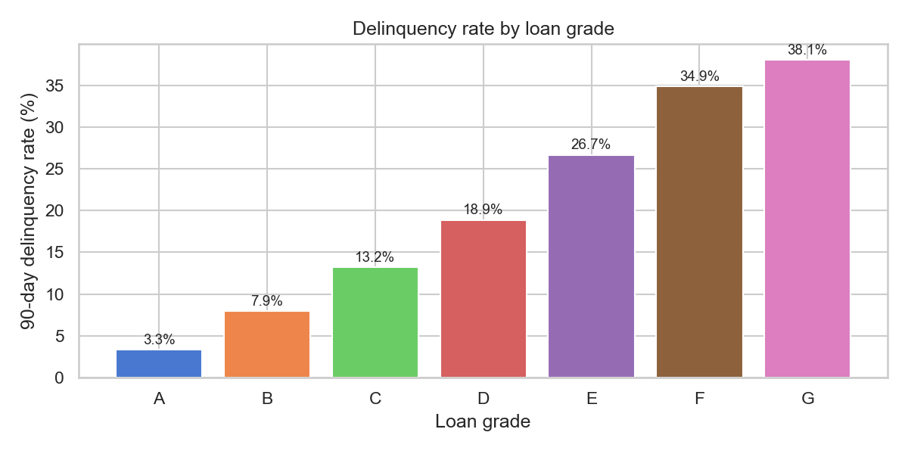
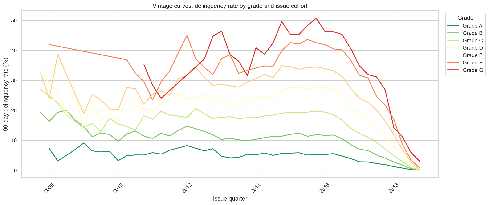
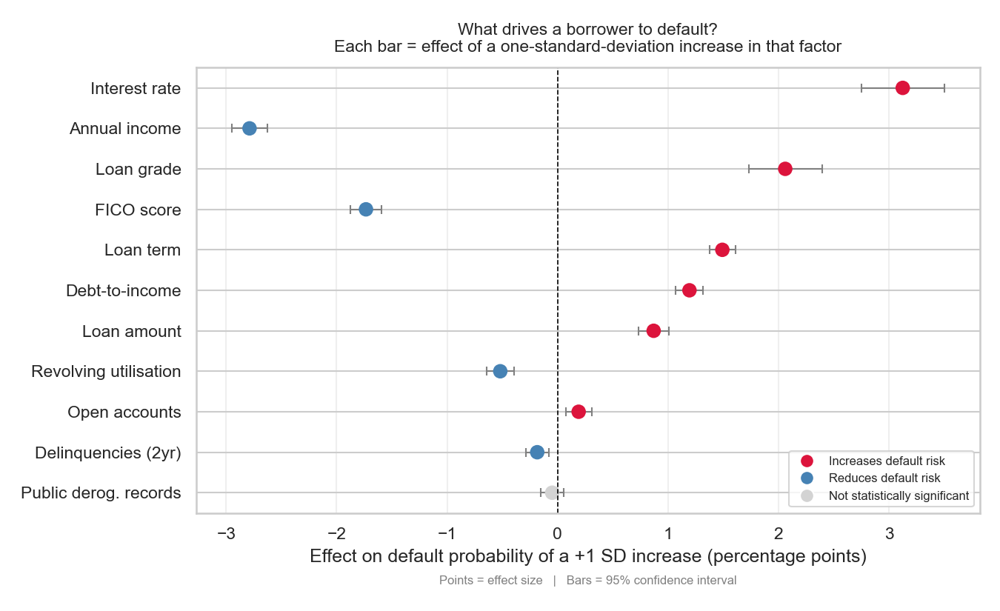
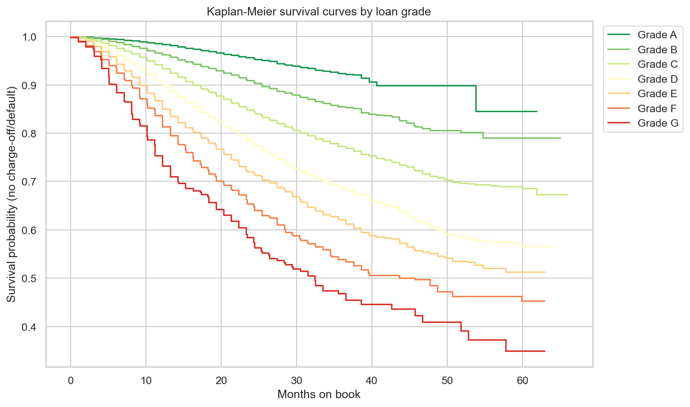
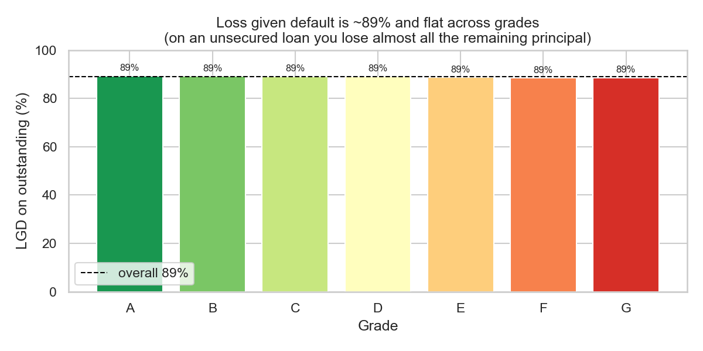
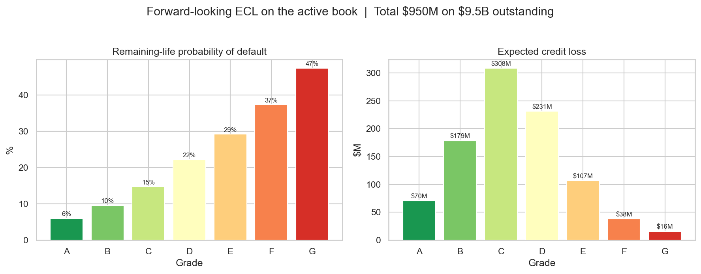
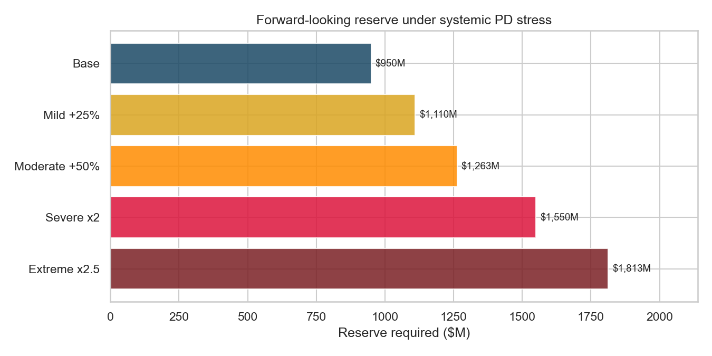

# Lending Club Credit Risk: Forward-Looking Loss Reserve

How much should a lender set aside today for losses on loans that are still open?

This project estimates that reserve for Lending Club's 2007-2018 consumer-loan book. It cleans 2.26 million loans, uses resolved outcomes and censored active loans to fit the survival models, then scores the 911,000 loans still open as of the March 2019 servicing snapshot.

The result is a loan-level expected credit loss model, stress scenarios, and a single-file browser dashboard.

[Try the live dashboard](https://thehoodedportal.github.io/Lending-Club-Credit-Risk/)

## Headline Result

| Measure | Result |
|---|---:|
| Open loans | 911,000 |
| Outstanding principal | $9.5B |
| Base expected credit loss | $950M |
| Base reserve rate | 10.0% of outstanding |
| Reserve if default rates double | $1.55B |
| Stressed reserve rate | 16.3% of outstanding |

The base reserve is not a worst-case number. It is the model's current-condition estimate. The stress range is more useful for planning because consumer credit losses move together in downturns.

## What The Model Estimates

The reserve follows the expected-credit-loss framework:

```text
expected loss = probability of default × loss given default × exposure at default
```

That means each open loan needs three estimates:

| Component | Meaning | How this project estimates it |
|---|---|---|
| Probability of default (PD) | Chance the loan defaults over its remaining life | Cox survival models, conditioned on the loan's current age |
| Loss given default (LGD) | Share of the outstanding balance lost after default | Observed average loss on charged-off loans |
| Exposure at default (EAD) | Balance expected to remain if default occurs | Actual current balance rolled forward on the amortization schedule |

The key rule is that a loan is scored only with information available at the scoring date. Outcomes are used to train the model, not as predictors for open loans. The estimate has not been independently calibrated.

## Data Setup

The raw data is Lending Club's accepted-loans file, `accepted_2007_to_2018Q4.csv`. The servicing fields run through March 2019, so the project uses `2019-03-01` as the snapshot date.

A loan is treated as seriously delinquent if its status is:

- `Late (31-120 days)`
- `Default`
- `Charged Off`
- `Does not meet the credit policy. Status:Charged Off`

By that snapshot-status definition, 12.9% of all loans are classified as delinquent or defaulted; this is not a complete history of delinquency. Risk rises sharply by Lending Club grade, from Grade A to Grade G.



The data is split into two working groups:

- **Resolved loans:** fully paid, charged off, or defaulted loans with known outcomes. These contribute observed outcomes to the training history.
- **Active loans:** current, grace-period, or late loans still open at the snapshot. These are right-censored for training and reserved against.

Recent loans can look artificially safe because they have not had enough time to fail. The model handles that by using survival analysis rather than treating every current loan as permanently good.



## Default Risk

The project uses two views of default risk.

First, a logistic regression explains which application-time features separate safer borrowers from riskier borrowers. It is trained only on matured loans, although snapshot statuses can still miss earlier delinquency and do not guarantee final outcomes for loans that remain open. The out-of-time AUC on the matured 2015 cohort, predominantly 36-month loans, is 0.68.



The strongest signals are the lender's own pricing and grade, followed by borrower income and credit score. Interest rate and grade should be read together: they are highly correlated because the rate is largely set from the grade.

Second, the reserve needs timing, not just a lifetime yes/no probability. A Cox survival model estimates month-by-month default risk. Separate Cox models for 36- and 60-month terms estimate early payoff, because a loan that prepays can no longer default. The reserve walks both hazards forward together as competing risks.



The exploratory chart uses charge-off/default as the event and the same unvalidated timing proxy described below.

This lets the model score a loan from where it is today. A loan that has already survived 20 months is not treated like a brand-new loan; the model prices only the remaining term.

## Loss Severity

For charged-off loans, loss is measured on the outstanding principal at default:

```text
LGD = (principal still owed - recoveries) / principal still owed
```

Severity is not meaningfully predictable from the available borrower or loan features. A regression on grade, rate, FICO, income, term, and other fields explains less than 1% of LGD variation.

The project therefore uses the observed average: Lending Club recovered about 11 cents per dollar owed, so LGD is about 89%.



The fact that older loans usually lose fewer dollars is handled through EAD, not LGD. As a loan amortizes, there is less balance left to lose.

## Reserve Calculation

For each active loan, the model starts from its current age and current outstanding balance. Each future month has three possible outcomes:

- the loan defaults,
- the loan prepays,
- or the loan survives to the next month.

If default happens in a month, the loss is the LGD multiplied by the balance expected to remain in that month. Summing those probability-weighted losses across all months and all active loans gives the reserve.



Base result: **$950M** expected credit loss on **$9.5B** outstanding, or **10.0%** of the active book. Grade C contributes the largest dollar loss because it has the most outstanding balance, not because it is the riskiest grade.

Loans already `Late (31-120 days)`, and active loans with a positive balance at or past maturity, are reserved in full as a conservative assumption.

## Stress Scenarios

The stress test scales monthly default probabilities inside the competing-risk walk. That means stressed scenarios change both the chance of default and the expected timing of default.



| Scenario | Reserve | % of outstanding |
|---|---:|---:|
| Base | $950M | 10.0% |
| Mild stress (+25% default risk) | $1,110M | 11.7% |
| Moderate stress (+50% default risk) | $1,263M | 13.3% |
| Severe stress (2x default risk) | $1,550M | 16.3% |
| Extreme stress (2.5x default risk) | $1,813M | 19.1% |

With roughly 900,000 loans, individual borrower randomness mostly diversifies away. The bigger risk is systemic: an economy-wide shock that lifts default rates across the book at the same time.

## Backtest limitations

The earlier vintage comparison used outcomes observed through 2019 to train on loans issued through 2014. It therefore contained future information and is not a valid historical backtest. A proper out-of-time test requires dated servicing snapshots and recovery histories, which are not available in this dataset. The reserve is a model estimate, not an independently validated result.

## Interactive Dashboard

The dashboard is [`index.html`](index.html), also published here:

[https://thehoodedportal.github.io/Lending-Club-Credit-Risk/](https://thehoodedportal.github.io/Lending-Club-Credit-Risk/)

It lets you:

- score an example borrower profile,
- see remaining-life default probability,
- estimate exposure and expected loss,
- view the survival curve,
- and switch between portfolio stress scenarios.

The dashboard uses the model payload exported by `python/04_reserve.ipynb` to `output/dashboard_model.json`. `python/05_sync_dashboard.py` embeds that payload into `index.html` so the dashboard stays tied to the latest fitted model.

## Implementation Summary

| Step | Main task | Tools |
|---|---|---|
| Ingest | Load Lending Club data, clean fields, define snapshot age, split resolved vs active loans | `pandas`, `pyarrow` |
| Explore | Build delinquency, cohort, distribution, and correlation charts | `pandas`, `matplotlib`, `seaborn` |
| Model default | Fit application-time default model and survival models for default/prepayment timing | `scikit-learn`, `statsmodels`, `lifelines` |
| Model severity | Measure LGD from charged-off loans and test whether it is predictable | `pandas`, `statsmodels` |
| Reserve | Walk each active loan forward month by month and sum expected losses | `numpy`, `pandas` |
| Dashboard | Export fitted model values and embed them in the browser dashboard | `json`, `pathlib`, JavaScript |

## Project Layout

```text
.
├── index.html                       # single-file interactive dashboard
├── data/
│   ├── raw/                         # raw Lending Club CSV, not tracked
│   └── processed/                   # generated parquet, not tracked
├── output/
│   ├── dashboard_model.json         # dashboard model payload
│   └── figures/                     # generated charts used in this README
├── python/
│   ├── 00_ingest.py                 # load, clean, snapshot, feature engineering
│   ├── 01_eda.ipynb                 # exploratory charts
│   ├── 02_cohort.ipynb              # vintage and cohort analysis
│   ├── 03_models.ipynb              # default drivers, survival, LGD
│   ├── 04_reserve.ipynb             # reserve, stress scenarios, export
│   ├── 05_sync_dashboard.py         # embed dashboard_model.json into index.html
│   └── requirements.txt
└── README.md
```

## Running The Project

Install dependencies:

```bash
pip install -r python/requirements.txt
```

Download the Lending Club CSV from Kaggle and place it here:

```text
data/raw/accepted_2007_to_2018Q4.csv
```

Then run:

```bash
python python/00_ingest.py
jupyter notebook python/
```

Run the notebooks in order. After rerunning `04_reserve.ipynb`, refresh the dashboard payload:

```bash
python python/05_sync_dashboard.py
```

The validation run used a [public mirror](https://huggingface.co/datasets/codesignal/lending-club-loan-accepted/blob/main/accepted_2007_to_2018Q4.csv) of the CSV (SHA-256 `3eae03c28fd9d2e8a076ebeb73507e8d4d0f44d90500decdb0936e0933d1f36a`). Run the synthetic checks with `python -m unittest discover -s tests -v`.

The raw CSV is about 1.7GB and is not tracked. The cleaned parquet is generated by `00_ingest.py` and is also not tracked.

## Caveats

- Charge-off dates are unavailable; last payment is an unvalidated timing proxy and can precede charge-off. Missing event-time proxies are excluded from survival fitting.
- Payoffs in the final contractual month are treated as maturity; the dates have monthly precision.
- The data is from one unsecured consumer lender. The method transfers better than the exact numbers.
- There is no macroeconomic forecast. The stress scenarios stand in for recession or cycle effects.
- There is no explicit vintage-quality variable. If a cohort is underwritten worse than its application fields imply, the model can miss that.
- LGD is held flat at about 89%. This is supported by the data, but it ignores collection costs and the time value of recoveries.
- Loans already `Late (31-120 days)` and active loans past maturity with positive balances are reserved in full. These are conservative assumptions, not calibrated probabilities.
- The result should be read as a reserve range, not a single certain number.

## Data Source

[Lending Club Loan Data on Kaggle](https://www.kaggle.com/datasets/wordsforthewise/lending-club): `accepted_2007_to_2018Q4.csv`
